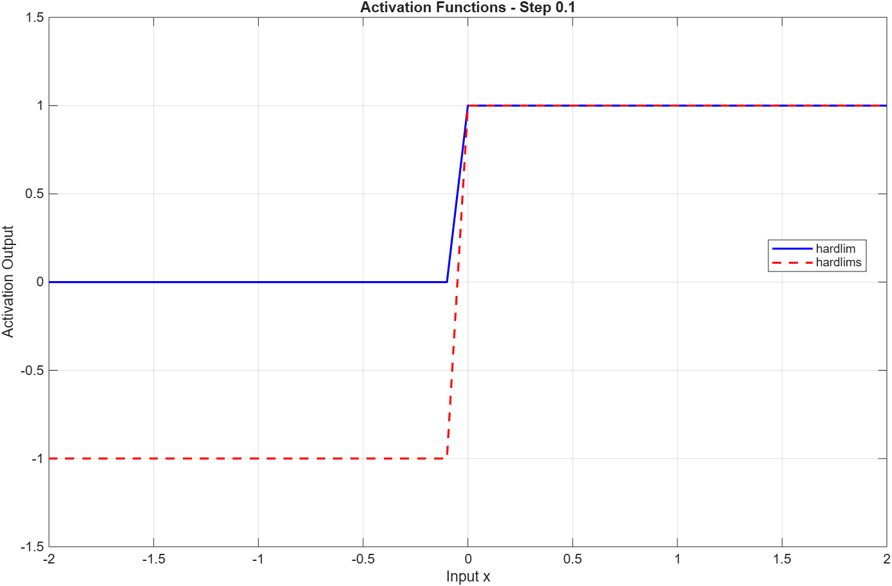
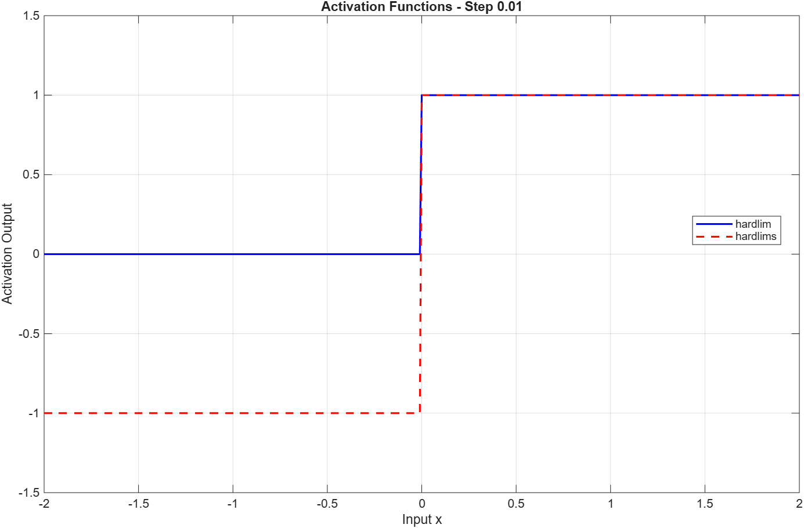

# Lab 01 – MATLAB Fundamentals

## Overview

This laboratory introduces MATLAB as a numerical computing and programming environment for Artificial Intelligence Systems (SIA).

The work focuses on mathematical computations, vector and matrix operations, numerical methods, data visualization, and introductory artificial intelligence concepts.

| Field | Value |
|---|---|
| Course | Artificial Intelligence Systems (SIA) |
| Software | MATLAB R2026b |
| Programming Language | MATLAB |
| Laboratory | 01 |
| Status | Completed |

## Learning Objectives

The main objectives of this laboratory are:

- Understand the MATLAB programming environment.
- Perform scalar calculations using mathematical functions.
- Work with vectors and matrices.
- Apply matrix algebra and numerical methods.
- Generate random data and calculate descriptive statistics.
- Visualize artificial neuron activation functions.
- Calculate and verify Moore–Penrose pseudoinverses.

## Project Structure

The laboratory contains three main directories:

| Directory | Description |
|---|---|
| `examples/` | Introductory MATLAB implementations |
| `exercises/` | Solutions to the 14 laboratory problems |
| `results/` | Execution screenshots and graphical results |

All implementations and documentation were developed as part of the learning process.

## Implemented Exercises

### Section 1 – Scalar Calculations

| Problem | Description | Implementation | Results |
|---|---|---|---|
| 01 | Roots, logarithms and trigonometric expressions | [MATLAB](exercises/problem01_scalar_calculations.m) | [PNG](results/problem01_results.png) |
| 02 | Scalar expression evaluation | [MATLAB](exercises/problem02_scalar_expression.m) | [PNG](results/problem02_results.png) |
| 03 | Conversion to mathematical notation | [Markdown](exercises/problem03_mathematical_notation.md) | Documentation |
| 04 | Unit conversions and rational approximations | [MATLAB](exercises/problem04_conversions_approximations.m) | [PNG](results/problem04_results.png) |
| 05 | Mathematical expression evaluation | [MATLAB](exercises/problem05_mathematical_expression.m) | [PNG](results/problem05_results.png) |
| 06 | Arithmetic, trigonometric and exponential operations | [MATLAB](exercises/problem06_mathematical_operations.m) | [PNG](results/problem06_results.png) |
| 07 | Scalar functions using a catalog index | [MATLAB](exercises/problem07_scalar_functions.m) | [PNG](results/problem07_results.png) |

### Section 2 – Vectors and Matrices

| Problem | Description | Implementation | Results |
|---|---|---|---|
| 08 | Determinants, inverses, powers and transposes | [MATLAB](exercises/problem08_matrix_operations.m) | [3×3](results/problem08_matrix3x3_results.png) / [4×4](results/problem08_matrix4x4_results.png) |
| 09 | Vector generation and matrix concatenation | [MATLAB](exercises/problem09_vectors_matrices.m) | [PNG](results/problem09_vectors_matrices_results.png) |
| 10 | Random number generation and descriptive statistics | [MATLAB](exercises/problem10_random_statistics.m) | [PNG](results/problem10_random_statistics_results.png) |
| 11 | Scalar triple product using two methods | [MATLAB](exercises/problem11_scalar_triple_product.m) | [PNG](results/problem11_scalar_triple_product_results.png) |
| 12 | Matrix polynomial evaluation | [MATLAB](exercises/problem12_matrix_polynomial.m) | [PNG](results/problem12_matrix_polynomial_results.png) |

**Problem 08 – Analytical Verification:**

[View analytical calculations](exercises/problem08_analytical_verification.md)

### Section 3 – Artificial Intelligence Applications

| Problem | Description | Implementation | Results |
|---|---|---|---|
| 13 | Hardlim and Hardlims activation functions | [MATLAB](exercises/problem13_activation_functions.m) | [Step 0.1](results/problem13_activation_step01.png) / [Step 0.01](results/problem13_activation_step001.png) |
| 14 | Moore–Penrose pseudoinverse | [MATLAB](exercises/problem14_moore_penrose_pseudoinverse.m) | [P1](results/problem14_p1_results.png) / [P2](results/problem14_p2_results.png) |

## Selected Results

### Matrix Operations

Problem 08 explores matrix operations using 3×3 and 4×4 matrices.

For the 3×3 matrix with catalog index `n = 1`, the determinant is:

**det(A) = 546**

The matrix inverse was validated numerically using:

`A * inv(A) ≈ eye(3)`

Problem 12 evaluates the matrix polynomial:

**B = A³ − 2A² − A + 14I**

For the specified matrix, the resulting matrix is zero, illustrating the Cayley–Hamilton theorem.

### Scalar Triple Product

Problem 11 calculates the scalar triple product using two approaches:

- `dot(a, cross(b,c))`
- `det([a; b; c])`

Both methods produce a result of **7**, with a negligible floating-point difference.

### Artificial Neuron Activation Functions

Problem 13 implements two activation functions:

- **Hardlim:** produces 0 for negative inputs and 1 otherwise.
- **Hardlims:** produces -1 for negative inputs and 1 otherwise.

Both functions were plotted over the interval [-2, 2] using step sizes of 0.1 and 0.01.

**Step size: 0.1**

**Step size: 0.01**

### Moore–Penrose Pseudoinverse

Problem 14 calculates pseudoinverses for two matrices using:

1. MATLAB's `pinv()` function.
2. The analytical formula `(P'P)^(-1)P'`, applicable when P has full column rank.

The results are compared using matrix norms.

The four Moore–Penrose conditions are numerically verified, and the differences are evaluated against floating-point precision.

The experiments demonstrate why the pseudoinverse is useful for non-square matrices and least-squares problems.

## How to Run

**Requirements**

- MATLAB, with R2026b used during development.
- No additional toolbox is required for the implemented activation function definitions.

**Instructions**

1. Open MATLAB.
2. Navigate to the `exercises/` directory.
3. Open the desired `.m` script.
4. Run it using the **Run** button or `F5`.
5. Review the numerical output in the Command Window or inspect the generated figures.

For exercises that depend on the catalog index, the value **n = 1** is used.

## Conclusions

This laboratory strengthened fundamental MATLAB programming and numerical computing skills.

The exercises demonstrated:

- How mathematical expressions are translated into executable code.
- How vectors and matrices are manipulated and analyzed.
- The importance of numerical precision and reproducibility.
- How activation functions can be implemented and visualized.
- How pseudoinverses can be calculated and validated.

These concepts provide a foundation for subsequent laboratories involving classification, machine learning algorithms, and state-space search.

## Academic Integrity

This directory contains independently implemented exercises, original documentation, and generated results.

Original instructor-provided laboratory handouts and course materials are not included in the repository.